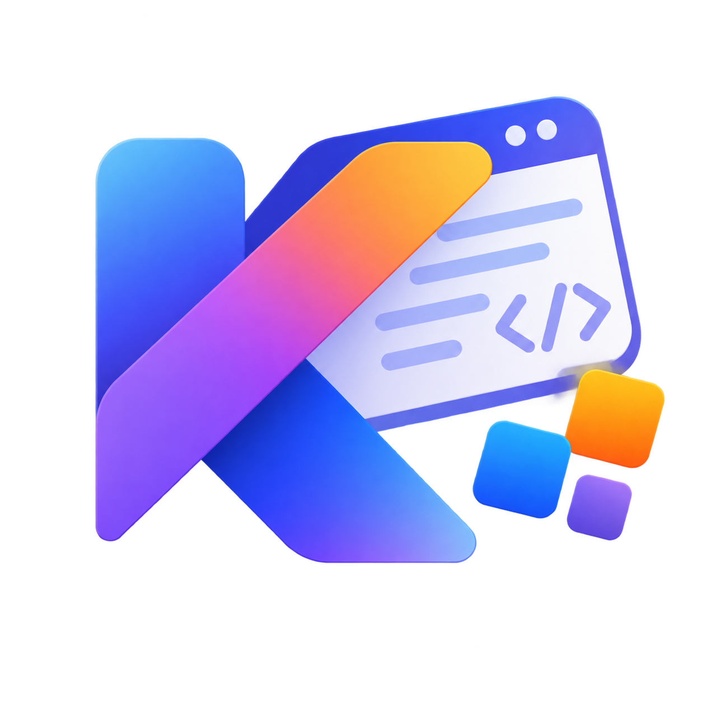

# ktjs-xterm

<p align="center"></p>

A Kotlin/JS wrapper for [`@xterm/xterm`](https://www.npmjs.com/package/@xterm/xterm): the terminal, its
buffers, its events, and five of the addons published alongside it.

[English](README.md) | [简体中文](README.zh-CN.md)

**[Documentation](https://shijianjs.github.io/ktjs-xterm/)** ·
**[Live demo](https://shijianjs.github.io/ktjs-xterm/demo/)** ·
**[API reference](https://shijianjs.github.io/ktjs-xterm/api/)**

```kotlin
val terminal = Xterm.create(options { cols = 80; rows = 24; convertEol = true })
terminal.open(host)
terminal.write("\u001b[32mready\u001b[0m\r\n")
terminal.onData.listen { data -> terminal.write(data) }
```

## Modules

| Module | npm package | Wrapper version |
| --- | --- | --- |
| [ktjs-xterm](ktjs-xterm/README.md) | `@xterm/xterm` (addons from `@xterm/addon-*`) | `6.0.0-kt.1` |

## What the wrapper maps

| Upstream | Kotlin |
| --- | --- |
| `Terminal` class | `Terminal`, built through `Xterm.create` |
| `ITerminalOptions & ITerminalInitOnlyOptions` (the constructor argument) | `ITerminalConstructorOptions : ITerminalOptions, ITerminalInitOnlyOptions` |
| `IEvent<T>` (a callable object) | `TerminalEvent<T>` / `VoidEvent` function types with `listen` |
| `IBufferNamespace` → `IBuffer` → `IBufferLine` → `IBufferCell` | same names |
| `ITerminalAddon` | `ITerminalAddon`; `loadAddon` is typed |
| `addon-fit` / `addon-search` / `addon-serialize` / `addon-unicode11` / `addon-web-links` | `addon.FitAddon` / `SearchAddon` / `SerializeAddon` / `Unicode11Addon` / `WebLinksAddon` |

The other ten addons are deliberately not wrapped; the reason per addon is in
[docs/development/coverage.md](docs/development/coverage.md).

## Versioning

Each module is versioned as `{upstream npm version}-kt.{revision}`. The upstream npm versions are
declared once in the root [`package.json`](package.json); the revision is read per module from
[`wrapper-revisions.properties`](wrapper-revisions.properties). Gradle derives the base version and
the `npm(...)` dependency from these two files:

- Only `-kt.N` versions are published; a version without the suffix never exists.
- A working tree always adds `-SNAPSHOT`: the derived number is the *next* release, which Central does
  not have yet, so development builds never impersonate it. Publishing passes `-Pktjs.release=true`,
  which drops the suffix.
- Upstream upgrade: change the version in `package.json`; the base version follows automatically
  while the revision stays, even when the wrapper code itself did not change.
- Wrapper-only fix: the revision increments (`kt.2`, `kt.3`, ...) while the base version stays.

## Requirements

- JDK 21 or newer (the build uses Gradle 9.4.1).
- Node and npm are downloaded automatically by the Kotlin Gradle plugin; `kotlin.js.yarn=false` in
  `gradle.properties` keeps npm as the package manager.
- Chromium is downloaded by Playwright the first time browser tests run.

## Build and test

```bash
./gradlew build                    # compile, Detekt, browser tests
./gradlew :ktjs-xterm:jsBrowserTest

# End-to-end checks for the demo page (Playwright, against the bundled output)
./gradlew :demo:e2eTest

# Documentation site: Kotlin configuration, Markdown pages, built by ktjs-docusaurus
./gradlew :docs:docusaurusBuild

# GitHub Pages site (documentation at the root, demo under /demo/, Dokka output under /api/)
./gradlew pagesSite
```

After adding or upgrading an npm dependency, refresh the shared lock file:

```bash
./gradlew kotlinUpgradePackageLock
```

The `docs` module is a Kotlin/JS project too. The ktjs-docusaurus versions live in
`gradle.properties` because each of those modules carries its own revision. A SNAPSHOT there is
resolved from `mavenLocal`. The kit's browser bundle is not a Maven artifact: it ships as a resource
of the kit's klib, and `extractKitBundle` copies it to the site's `static/ktjs-client/`.

## Publishing

Publishing is configured once in the root [`build.gradle.kts`](build.gradle.kts) for all modules.
Releases run through `.github/workflows/release.yml`: it signs the artifacts, packages one archive per
Maven coordinate and registers them with the shared Maven Central hub, which merges the pending
registrations into a single deployment.

## License

Released under the [MIT License](LICENSE). `@xterm/xterm` and the wrapped addons are MIT too, © The
xterm.js authors — see [Licensing](https://shijianjs.github.io/ktjs-xterm/guide/licensing).
