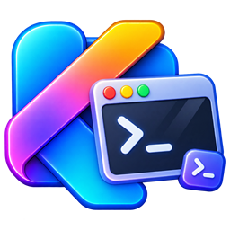

# ktjs-xterm

<p align="center"></p>

[`@xterm/xterm`](https://www.npmjs.com/package/@xterm/xterm) 的 Kotlin/JS 封装：终端本体、它的缓冲区、
它的事件，以及随上游一起发布的 addon 中的五个。

[English](README.md) | [简体中文](README.zh-CN.md)

**[文档](https://shijianjs.github.io/ktjs-xterm/)** ·
**[在线演示](https://shijianjs.github.io/ktjs-xterm/demo/)** ·
**[API 文档](https://shijianjs.github.io/ktjs-xterm/api/)**

```kotlin
val terminal = Xterm.create(options { cols = 80; rows = 24; convertEol = true })
terminal.open(host)
terminal.write("\u001b[32mready\u001b[0m\r\n")
terminal.onData.listen { data -> terminal.write(data) }
```

## 模块

| 模块 | npm 包 | wrapper 版本 |
| --- | --- | --- |
| [ktjs-xterm](ktjs-xterm/README.zh-CN.md) | `@xterm/xterm`（addon 来自 `@xterm/addon-*`） | `6.0.0-kt.1` |

## 封装了什么

| 上游 | Kotlin |
| --- | --- |
| `Terminal` 类 | `Terminal`，通过 `Xterm.create` 构造 |
| `ITerminalOptions & ITerminalInitOnlyOptions`（构造参数） | `ITerminalConstructorOptions : ITerminalOptions, ITerminalInitOnlyOptions` |
| `IEvent<T>`（可调用对象） | `TerminalEvent<T>` / `VoidEvent` 函数类型 + `listen` 扩展 |
| `IBufferNamespace` → `IBuffer` → `IBufferLine` → `IBufferCell` | 同名 |
| `ITerminalAddon` | `ITerminalAddon`；`loadAddon` 有类型 |
| `addon-fit` / `addon-search` / `addon-serialize` / `addon-unicode11` / `addon-web-links` | `addon.FitAddon` / `SearchAddon` / `SerializeAddon` / `Unicode11Addon` / `WebLinksAddon` |

其余十个 addon 刻意不封装，逐个的理由写在
[docs/development/coverage.md](docs/development/coverage.md)。

## 版本约定

每个模块的版本是 `{上游 npm 版本}-kt.{修订号}`。上游 npm 版本只在根
[`package.json`](package.json) 里声明；修订号按模块记在
[`wrapper-revisions.properties`](wrapper-revisions.properties)。Gradle 由这两个文件推出 base 版本与
`npm(...)` 依赖：

- 只发布 `-kt.N` 版本；不带后缀的版本号从来不存在。
- 工作树总加 `-SNAPSHOT`：推出的号是*下一个*发布版本，Central 上还没有，所以开发构建不会冒充它。
  发布时传 `-Pktjs.release=true` 去掉后缀。
- 升级上游：改 `package.json` 里的版本，base 版本自动跟随，修订号不动，即使封装代码没变。
- 只修封装：修订号递增（`kt.2`、`kt.3`……），base 版本不动。

## 环境要求

- JDK 21 或更新（构建用 Gradle 9.4.1）。
- Node 与 npm 由 Kotlin Gradle 插件自动下载；`gradle.properties` 里 `kotlin.js.yarn=false` 保持用 npm。
- 首次跑浏览器测试时，Playwright 会下载 Chromium。

## 构建与测试

```bash
./gradlew build                    # 编译、Detekt、浏览器测试
./gradlew :ktjs-xterm:jsBrowserTest

# demo 页的端到端检查（Playwright，打的是打包后的产物）
./gradlew :demo:e2eTest

# 文档站：Kotlin 配置、Markdown 页面，由 ktjs-docusaurus 构建
./gradlew :docs:docusaurusBuild

# GitHub Pages 站点（根目录是文档，/demo/ 是演示，/api/ 是 Dokka 输出）
./gradlew pagesSite
```

新增或升级 npm 依赖后，刷新共享锁文件：

```bash
./gradlew kotlinUpgradePackageLock
```

`docs` 模块同样是 Kotlin/JS 项目。ktjs-docusaurus 的几个版本写在 `gradle/libs.versions.toml`，因为它们各自带修订号；
那里写 SNAPSHOT 时从 `mavenLocal` 解析。kit 的浏览器 bundle 不是 Maven 产物：它以资源形式随 kit 的 klib 走，
`extractKitBundle` 把它拷到站点的 `static/ktjs-client/`。

## 发布

发布在根 [`build.gradle.kts`](build.gradle.kts) 里对所有模块统一配置。发布流程走
`.github/workflows/release.yml`：签名产物、按 Maven 坐标各打一个包，注册到共享的 Maven Central hub，
由它把待发布的登记合并成一次部署。

## 许可证

以 [MIT License](LICENSE) 发布。`@xterm/xterm` 与所封装的 addon 同样是 MIT，版权归 The xterm.js authors——
见[许可证](https://shijianjs.github.io/ktjs-xterm/zh-Hans/guide/licensing)。
