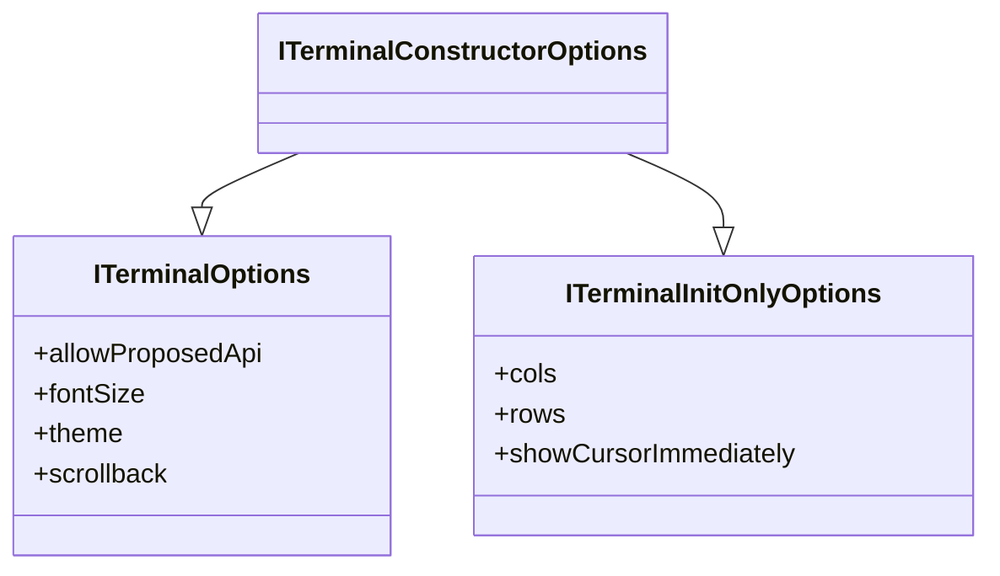
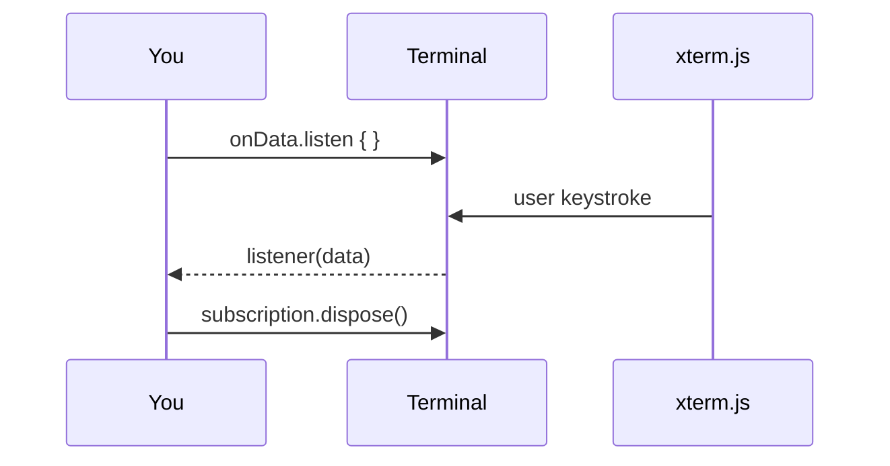

# Usage

## Creating a terminal

`Xterm.create` takes the one options object upstream's constructor reads. The wrapper builds it with a
lambda:

```kotlin
val terminal = Xterm.create(
    options {
        cols = 80                    // init-only: honoured by the constructor
        rows = 24
        fontSize = 14.0              // CSS pixels
        fontFamily = "ui-monospace"
        cursorBlink = true
        convertEol = true            // "\n" also moves to column 0
        theme = terminalTheme {
            background = "#0d1117"
            foreground = "#e6edf3"
            cursor = "#58a6ff"
        }
    },
)
```

Upstream declares the constructor parameter as `ITerminalOptions & ITerminalInitOnlyOptions` — one
object carrying both sets of keys. Kotlin has no intersection type for external declarations, so the
wrapper declares `ITerminalConstructorOptions : ITerminalOptions, ITerminalInitOnlyOptions` and that is
the type the constructor takes.



## Options after construction

The live object is `terminal.options`; assigning a field applies it in place:

```kotlin
terminal.options.fontSize = 16.0
terminal.options.theme = terminalTheme { background = "#000000" }
```

For object-valued options a new object is required: upstream compares by reference, so mutating the old
theme in place changes nothing.

## Events

`IEvent<T>` is a callable object in JavaScript — `terminal.onData(listener)`. Kotlin models it as a
function type, so the wrapper's `listen` extension is a plain call:

```kotlin
val subscription = terminal.onData.listen { data -> terminal.write(data) }
subscription.dispose()
```

| Event | Payload |
| --- | --- |
| `onBell`, `onLineFeed`, `onCursorMove`, `onWriteParsed`, `onSelectionChange` | none |
| `onData`, `onTitleChange`, `onBinary` | `String` |
| `onKey` | `IKeyEvent` (`key`, `domEvent`) |
| `onResize` | `IResizeEvent` (`cols`, `rows`) |
| `onRender` | `IRenderRange` (`start`, `end`) |
| `onScroll` | `Int` (lines scrolled) |
| `onDimensionsChange` | `IRenderDimensions` |



## Buffers

`terminal.buffer.active` is the buffer the user sees; `normal` and `alternate` are both available, and
`onBufferChange` fires when the active one switches (an alternate-screen program starting, for instance).

```kotlin
val buffer = terminal.buffer.active
val line = buffer.getLine(buffer.baseY + buffer.cursorY)
val text = line?.translateToString(true)   // `true` trims trailing blanks

val cell = line?.getCell(0)
cell?.getChars()
cell?.isBold()
```

## Writing

```kotlin
terminal.write("\u001b[32mok\u001b[0m\r\n")
terminal.write(bytes)                      // Uint8Array<ArrayBuffer>, for binary streams
terminal.write(data, { /* parsed and rendered */ })
terminal.writeln("plain line")
terminal.paste("text")                     // honours bracketed paste mode
```

## Addons

Each addon is its own npm package, mirrors upstream's class and is loaded through the terminal:

```kotlin
val fit = FitAddon().also { terminal.loadAddon(it) }
fit.fit()
fit.proposeDimensions()                    // null until the terminal is opened

val search = SearchAddon().also { terminal.loadAddon(it) }
search.findNext("error", null)

val links = WebLinksAddon().also { terminal.loadAddon(it) }

val serialize = SerializeAddon().also { terminal.loadAddon(it) }
serialize.serialize()                      // the content as an escape-sequence stream
serialize.serializeAsHTML()                // ... or as HTML

val unicode = Unicode11Addon().also { terminal.loadAddon(it) }
terminal.unicode.activeVersion = "11"      // the addon only registers the table
```

| Upstream addon | Wrapped | Why |
| --- | --- | --- |
| `addon-fit` | yes | layout is the first thing every embedder needs |
| `addon-web-links` | yes | pure DOM, no extra state |
| `addon-search` | yes | buffer-level API with typed events |
| `addon-serialize` | yes | writes the buffer back out |
| `addon-unicode11` | yes | one call, one provider |
| `addon-attach`, `addon-clipboard`, `addon-image`, `addon-ligatures`, `addon-program-status`, `addon-progress`, `addon-unicode-graphemes`, `addon-web-fonts`, `addon-webgl` | no | they pull in DOM/WebGL/canvas side effects or a specific transport; see the coverage document |

## Where the wrapper stops

The wrapper declares types; it never reimplements upstream. Rendering, key handling and the escape
parser stay entirely in `@xterm/xterm`. The parser hooks are exposed as `IParser` with `JsAny`
callbacks, because upstream lets a handler return either a `Boolean` or a `Promise<Boolean>`.
