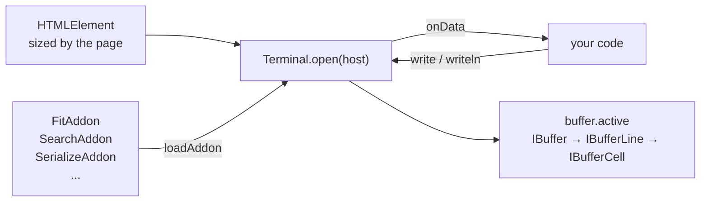

# ktjs-xterm

A Kotlin/JS wrapper for [`@xterm/xterm`](https://github.com/xtermjs/xterm.js): the terminal itself, the
buffers it exposes, and five of the addons the upstream repository publishes — each reached through its
own npm package.

```kotlin
val terminal = Xterm.create(
    options {
        cols = 80
        rows = 24
        fontSize = 14.0
        theme = terminalTheme { background = "#0d1117"; foreground = "#e6edf3" }
    },
)

terminal.open(container)                       // a sized HTMLElement
terminal.write("\u001b[32mhello\u001b[0m\r\n")
terminal.onData.listen { data -> terminal.write(data) }
```

## What the module contains

| npm package | Kotlin entry point | What it adds |
| --- | --- | --- |
| `@xterm/xterm` | `Terminal`, `Xterm.create` | the terminal: `open`, `write`, `resize`, buffers, events, parser |
| `@xterm/addon-fit` | `addon.FitAddon` | resizes the terminal to its container |
| `@xterm/addon-web-links` | `addon.WebLinksAddon` | turns URLs in the output into links |
| `@xterm/addon-search` | `addon.SearchAddon` | finds and highlights text in the buffer |
| `@xterm/addon-serialize` | `addon.SerializeAddon` | writes the content back out as a stream or HTML |
| `@xterm/addon-unicode11` | `addon.Unicode11Addon` | registers the Unicode 11 width table |



## Reading order

1. [Getting started](guide/getting-started.md) — the dependency, a build, the first terminal.
2. [Usage](guide/usage.md) — options, events, buffers, addons, and the shapes the wrapper narrows.
3. [Licensing](guide/licensing.md) — the MIT terms of both halves.

The [demo](https://shijianjs.github.io/ktjs-xterm/demo/) is a running consumer of this module, and the
[API reference](https://shijianjs.github.io/ktjs-xterm/api/) is the Dokka output for every declaration
this module publishes.
