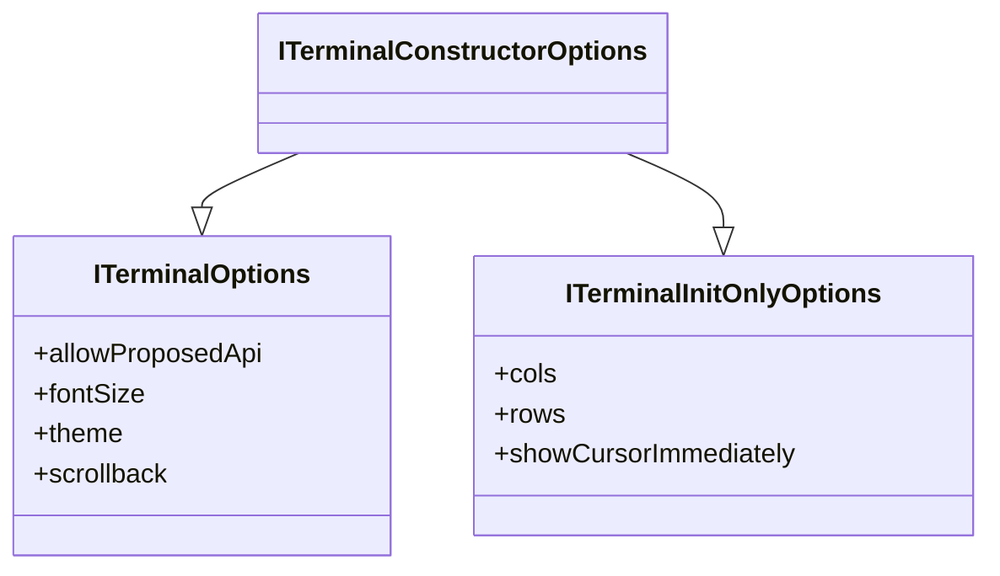
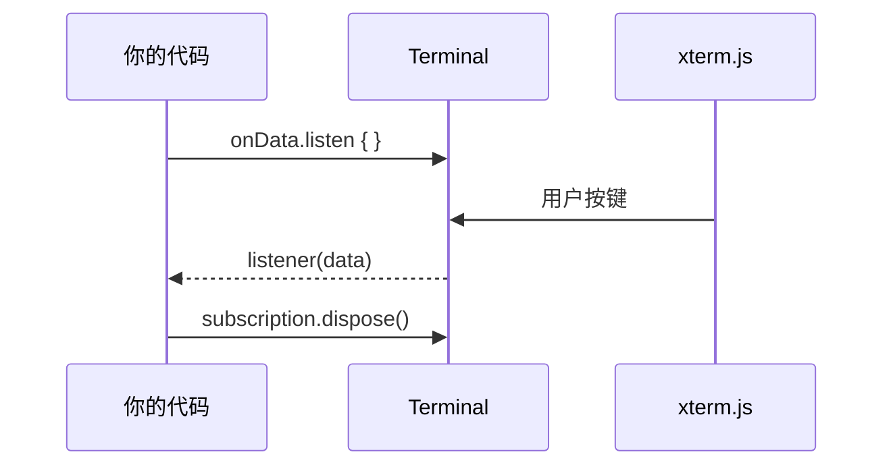

# 用法

## 创建终端

`Xterm.create` 接收上游构造器读取的那一个选项对象。封装层用一个 lambda 来搭它：

```kotlin
val terminal = Xterm.create(
    options {
        cols = 80                    // 仅构造期生效：由构造器读取
        rows = 24
        fontSize = 14.0              // CSS 像素
        fontFamily = "ui-monospace"
        cursorBlink = true
        convertEol = true            // "\n" 同时回到第 0 列
        theme = terminalTheme {
            background = "#0d1117"
            foreground = "#e6edf3"
            cursor = "#58a6ff"
        }
    },
)
```

上游把构造参数声明为 `ITerminalOptions & ITerminalInitOnlyOptions`——一个对象同时带两组键。Kotlin 的 external 声明
没有交叉类型，所以封装层声明了 `ITerminalConstructorOptions : ITerminalOptions, ITerminalInitOnlyOptions`，
构造器就接收这个类型。



## 构造之后改选项

活的对象是 `terminal.options`，给字段赋值就地生效：

```kotlin
terminal.options.fontSize = 16.0
terminal.options.theme = terminalTheme { background = "#000000" }
```

对象型选项必须**换新对象**：上游按引用比较，就地改旧 theme 不会产生任何变化。

## 事件

在 JavaScript 里 `IEvent<T>` 是可调用对象——`terminal.onData(listener)`。Kotlin 把它建模成函数类型，
于是封装层的 `listen` 扩展就是一次普通调用：

```kotlin
val subscription = terminal.onData.listen { data -> terminal.write(data) }
subscription.dispose()
```

| 事件 | 载荷 |
| --- | --- |
| `onBell`、`onLineFeed`、`onCursorMove`、`onWriteParsed`、`onSelectionChange` | 无 |
| `onData`、`onTitleChange`、`onBinary` | `String` |
| `onKey` | `IKeyEvent`（`key`、`domEvent`） |
| `onResize` | `IResizeEvent`（`cols`、`rows`） |
| `onRender` | `IRenderRange`（`start`、`end`） |
| `onScroll` | `Int`（滚过的行数） |
| `onDimensionsChange` | `IRenderDimensions` |



## 缓冲区

`terminal.buffer.active` 是用户看到的那块缓冲区；`normal` 与 `alternate` 都可用，切换时 `onBufferChange` 触发
（例如全屏程序启动了备用屏）。

```kotlin
val buffer = terminal.buffer.active
val line = buffer.getLine(buffer.baseY + buffer.cursorY)
val text = line?.translateToString(true)   // `true` 去掉行尾空白

val cell = line?.getCell(0)
cell?.getChars()
cell?.isBold()
```

## 写内容

```kotlin
terminal.write("\u001b[32mok\u001b[0m\r\n")
terminal.write(bytes)                      // Uint8Array<ArrayBuffer>，接二进制流
terminal.write(data, { /* 已解析并渲染 */ })
terminal.writeln("plain line")
terminal.paste("text")                     // 遵守括号粘贴模式
```

## addon

每个 addon 是独立 npm 包，类与上游一一对应，通过终端装载：

```kotlin
val fit = FitAddon().also { terminal.loadAddon(it) }
fit.fit()
fit.proposeDimensions()                    // 终端未 open 时为 null

val search = SearchAddon().also { terminal.loadAddon(it) }
search.findNext("error", null)

val links = WebLinksAddon().also { terminal.loadAddon(it) }

val serialize = SerializeAddon().also { terminal.loadAddon(it) }
serialize.serialize()                      // 内容导出为转义序列流
serialize.serializeAsHTML()                // ……或 HTML

val unicode = Unicode11Addon().also { terminal.loadAddon(it) }
terminal.unicode.activeVersion = "11"      // addon 只负责注册表，切换要自己设
```

| 上游 addon | 是否封装 | 原因 |
| --- | --- | --- |
| `addon-fit` | 是 | 布局是每个集成方最先要的东西 |
| `addon-web-links` | 是 | 纯 DOM，无额外状态 |
| `addon-search` | 是 | 缓冲区级 API，带强类型事件 |
| `addon-serialize` | 是 | 把缓冲区重新写出来 |
| `addon-unicode11` | 是 | 一次调用、一个 provider |
| `addon-attach`、`addon-clipboard`、`addon-image`、`addon-ligatures`、`addon-program-status`、`addon-progress`、`addon-unicode-graphemes`、`addon-web-fonts`、`addon-webgl` | 否 | 会带进 DOM/WebGL/canvas 副作用，或只面向某种具体传输；见覆盖文档 |

## 封装层止于何处

封装层只声明类型，从不重实现上游。渲染、按键处理、转义解析全部留在 `@xterm/xterm`。解析器钩子暴露为 `IParser`，
回调类型是 `JsAny`，因为上游允许处理器返回 `Boolean` 或 `Promise<Boolean>`。
