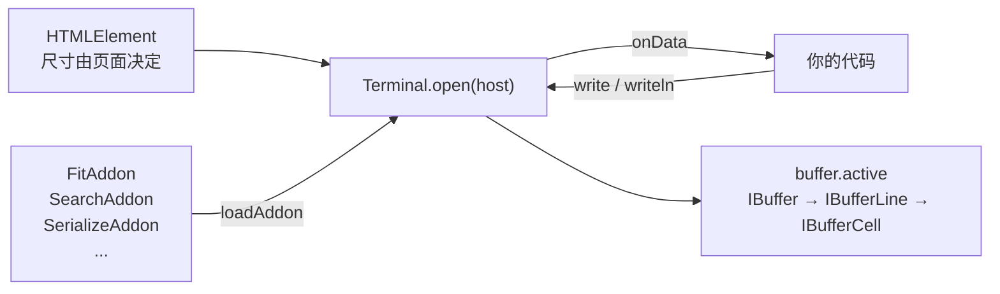

# ktjs-xterm

[`@xterm/xterm`](https://github.com/xtermjs/xterm.js) 的 Kotlin/JS 封装：终端本体、它暴露的缓冲区，以及上游仓库发布的 addon
中的五个——每个 addon 通过各自的 npm 包引入。

```kotlin
val terminal = Xterm.create(
    options {
        cols = 80
        rows = 24
        fontSize = 14.0
        theme = terminalTheme { background = "#0d1117"; foreground = "#e6edf3" }
    },
)

terminal.open(container)                       // 一个已有尺寸的 HTMLElement
terminal.write("\u001b[32mhello\u001b[0m\r\n")
terminal.onData.listen { data -> terminal.write(data) }
```

## 模块内容

| npm 包 | Kotlin 入口 | 作用 |
| --- | --- | --- |
| `@xterm/xterm` | `Terminal`、`Xterm.create` | 终端本体：`open`、`write`、`resize`、缓冲区、事件、解析器 |
| `@xterm/addon-fit` | `addon.FitAddon` | 按容器尺寸自适应 |
| `@xterm/addon-web-links` | `addon.WebLinksAddon` | 把输出里的 URL 变成链接 |
| `@xterm/addon-search` | `addon.SearchAddon` | 在缓冲区里查找并高亮 |
| `@xterm/addon-serialize` | `addon.SerializeAddon` | 把内容导出成转义序列流或 HTML |
| `@xterm/addon-unicode11` | `addon.Unicode11Addon` | 注册 Unicode 11 宽度表 |



## 阅读顺序

1. [快速开始](guide/getting-started.md) — 依赖、构建、第一个终端。
2. [用法](guide/usage.md) — 选项、事件、缓冲区、addon，以及封装层收窄过的那些形状。
3. [许可证](guide/licensing.md) — 两部分都在 MIT 之下。

[demo](https://shijianjs.github.io/ktjs-xterm/demo/) 是本模块的一个真实使用者，
[API 文档](https://shijianjs.github.io/ktjs-xterm/api/) 是本模块发布的每个声明的 Dokka 输出。
